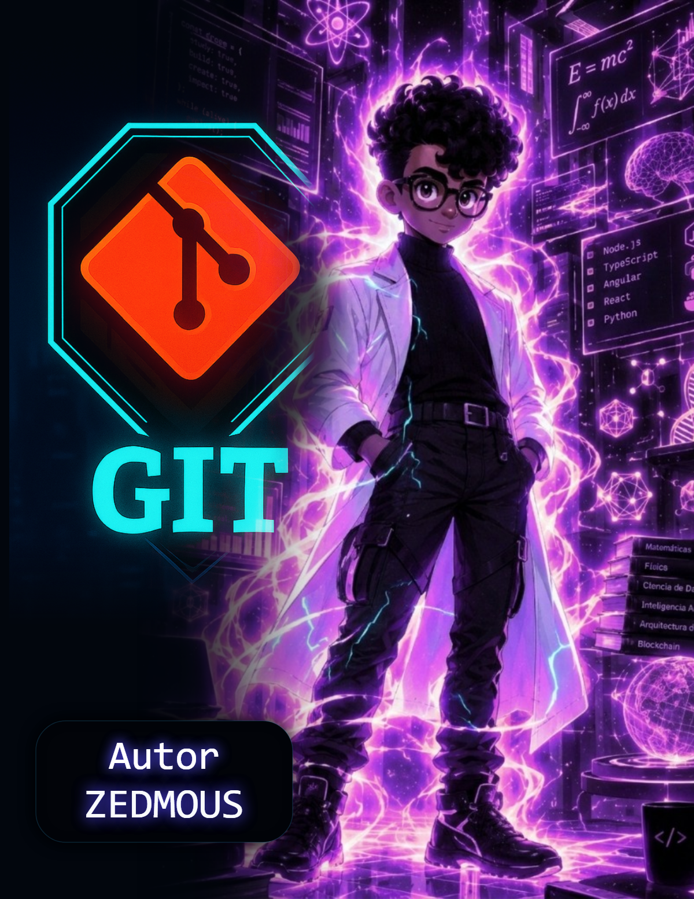
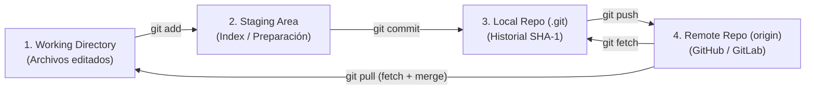

# ⚡ Guía Maestra & Laboratorio Práctico de Git y Control de Versiones (`zmgit`)

<p align="center">
  
</p>

<p align="center">
  <a href="https://zedmous.netlify.app/assets/docs/guia_git_zedmous.pdf"></a>
  <a href="https://zedmous.netlify.app"></a>
  
</p>

> **Autoría & Cátedra:** **Ing. Eduardo Nieves (`Zedmous`)** — Arquitecto de Software & Matemático  
> **Guía Oficial en PDF (7 Páginas):** [`docs/Guia_Maestra_Git_Control_de_Versiones_Zedmous.pdf`](./docs/Guia_Maestra_Git_Control_de_Versiones_Zedmous.pdf) | [Ver en línea en `zedmous.netlify.app`](https://zedmous.netlify.app/assets/docs/guia_git_zedmous.pdf)

---

## 📌 Índice de Contenidos

1. [Arquitectura de Git: Las 4 Áreas de Trabajo](#1-arquitectura-de-git-las-4-áreas-de-trabajo)
2. [Configuración Inicial (`git config`) e Inicialización (`git init`)](#2-configuración-inicial-git-config-e-inicialización-git-init)
3. [Diagnóstico del Repositorio (`git status` y `git status -s`)](#3-diagnóstico-del-repositorio-git-status-y-git-status--s)
4. [Preparación (`git add`), Confirmación (`git commit`) y Conventional Commits](#4-preparación-git-add-confirmación-git-commit-y-conventional-commits)
5. [Auditoría del Historial (`git log` y `git log --oneline --graph`)](#5-auditoría-del-historial-git-log-y-git-log---oneline---graph)
6. [Repositorios Remotos (`git clone`, `git remote`, `git push`, `git fetch`, `git pull`)](#6-repositorios-remotos-git-clone-git-remote-git-push-git-fetch-git-pull)
7. [Gestión de Ramas (`git branch`, `git checkout`, `git switch`)](#7-gestión-de-ramas-git-branch-git-checkout-git-switch)
8. [Fusión de Ramas (`git merge`) y Resolución de Conflictos (`UU`)](#8-fusión-de-ramas-git-merge-y-resolución-de-conflictos-uu)
9. [Laboratorio Práctico con este Repositorio (`app.js` y `Calculadora`)](#9-laboratorio-práctico-con-este-repositorio-appjs-y-calculadora)
10. [Examen Práctico de Autoevaluación (20 Preguntas con Solución)](#10-examen-práctico-de-autoevaluación-20-preguntas-con-solución)

---

## 1. Arquitectura de Git: Las 4 Áreas de Trabajo

Git es un **Sistema de Control de Versiones Distribuido (DVCS)** creado por Linus Torvalds. A diferencia de los sistemas centralizados, cada desarrollador posee una copia íntegra del historial en su directorio oculto `.git/`.



---

## 2. Configuración Inicial (`git config`) e Inicialización (`git init`)

Antes de realizar tu primer commit en un equipo nuevo, configura tu identidad global:

```bash
git config --global user.name "Tu Nombre"
git config --global user.email "tu_correo@ejemplo.com"
git config --global init.defaultBranch main
git config --list
```

Para convertir una carpeta local en un repositorio de Git:

```bash
git init
```

Esto crea la subcarpeta oculta **`.git/`**, donde viven todos los objetos, ramas, *commits* y configuraciones del proyecto.

---

## 3. Diagnóstico del Repositorio (`git status` y `git status -s`)

Muestra el estado actual de los archivos frente al área de preparación (*Staging*) y al último commit:

```bash
git status      # Vista explicativa completa
git status -s   # Vista resumida de dos columnas (XY)
```

| Código | Color en Consola | Significado Técnico |
| :---: | :---: | :--- |
| `??` | **Rojo** | **Untracked:** Archivo nuevo que Git aún no rastrea. |
| `A ` | **Verde** | **Added:** Archivo nuevo agregado al área de preparación (*Staging*). |
| ` M` | **Rojo** | **Modified (Working Tree):** Archivo modificado localmente, pero **no** preparado con `git add`. |
| `M ` | **Verde** | **Modified (Staged):** Cambio preparado en *Staging*, listo para `git commit`. |
| `MM` | **Verde + Rojo** | Modificado en *Staging* y vuelto a modificar después en el directorio de trabajo. |
| `UU` | **Rojo / Amarillo** | **Unmerged (Conflicto):** Ambas ramas modificaron las mismas líneas durante un `merge`. |

---

## 4. Preparación (`git add`), Confirmación (`git commit`) y Conventional Commits

### Preparar archivos (`git add`)
```bash
git add app.js                  # Prepara un archivo específico
git add clases/calculadora.js   # Prepara un módulo específico
git add .                       # Prepara todos los archivos nuevos y modificados
```

### Confirmar instantáneas (`git commit`)
```bash
git commit -m "feat: agregar operaciones básicas en app.js"
git commit -a -m "fix: validar división entre cero"   # Salta git add SOLO para archivos ya rastreados
```

> ⚠️ **Importante:** `git commit -a -m` **no incluye archivos nuevos (`??`)** que nunca hayan sido agregados antes con `git add`.

### Estándar Profesional: Conventional Commits
- `feat:` Nueva funcionalidad para el usuario.
- `fix:` Corrección de un error (*bug*).
- `docs:` Cambios exclusivamente en documentación (`README.md`, guías).
- `refactor:` Mejora de código sin cambiar su comportamiento externo.
- `test:` Adición o corrección de pruebas automatizadas.
- `chore:` Tareas de mantenimiento, dependencias o configuración (`.gitignore`, `package.json`).

---

## 5. Auditoría del Historial (`git log` y `git log --oneline --graph`)

```bash
git log                                       # Historial detallado (Autor, Fecha, Hash SHA-1 completo)
git log --oneline                             # Resumen compacto: Hash corto (7 caracteres) + mensaje
git log --oneline --graph --decorate --all    # Grafo visual de todas las ramas y fusiones
```

---

## 6. Repositorios Remotos (`git clone`, `git remote`, `git push`, `git fetch`, `git pull`)

### Clonar y administrar remotos
```bash
git clone https://github.com/Zedmous/zmgit.git
git remote -v                                                   # Ver URLs remotas actuales
git remote add origin https://github.com/Zedmous/zmgit.git      # Enlazar remoto por primera vez
git remote set-url origin https://github.com/Zedmous/zmgit.git  # Actualizar URL del remoto
git remote remove origin                                        # Desvincular remoto
```

### Subir y descargar cambios
```bash
# Primera subida de una rama (establece el tracking upstream):
git push --set-upstream origin main   # Equivalente corto: git push -u origin main

# Subidas posteriores:
git push

# Descargar metadatos y commits remotos SIN modificar tus archivos locales:
git fetch
git fetch --all                       # Descarga novedades de TODOS los remotos configurados

# Descargar y fusionar inmediatamente con tu rama actual (git fetch + git merge):
git pull
```

> 📌 **Nota Técnica de Cátedra:** **No existe `git pull --all`** para fusionar múltiples ramas o remotos a la vez, porque Git no permite fusiones múltiples automáticas que puedan provocar conflictos simultáneos sin supervisión.

---

## 7. Gestión de Ramas (`git branch`, `git checkout`, `git switch`)

```bash
git branch                 # Lista ramas locales (la rama activa tiene un *)
git branch -r              # Lista únicamente ramas remotas (origin/...)
git branch -a              # Lista TODAS las ramas (locales + remotas)
git branch rama-a          # Crea la rama 'rama-a' sin cambiarte a ella
git branch -d rama-a       # Elimina la rama de forma segura (solo si ya fue fusionada)
git branch -D rama-a       # Elimina la rama de forma FORZADA aunque tenga cambios sin fusionar
```

> ⚠️ **Regla:** Nunca puedes eliminar la rama en la que estás parado actualmente; primero cámbiate a `main` o `master`.

### Navegación entre ramas (`checkout` vs `switch`)
```bash
# Clásico (multiuso):
git checkout rama-a        # Cambia a 'rama-a' (si existe solo en el remoto, la descarga y rastrea)
git checkout -b rama-b     # Crea y cambia a 'rama-b'

# Moderno (Git 2.23+, semánticamente dedicado a ramas):
git switch rama-a          # Cambia a 'rama-a'
git switch -c rama-b       # Crea y cambia a 'rama-b'
```

---

## 8. Fusión de Ramas (`git merge`) y Resolución de Conflictos (`UU`)

Para integrar los cambios de `rama-a` dentro de tu rama principal (`main`):

```bash
git switch main
git merge rama-a
```

### ¿Cómo resolver un conflicto de fusión (`UU`)?
Cuando dos ramas modificaron las mismas líneas del mismo archivo, Git detiene el *merge* y marca el archivo como `UU` en `git status -s`:

```txt
<<<<<<< HEAD
const restar = (a, b) => a - b;
=======
const dividir = (a, b) => a / b;
>>>>>>> rama-b
```

1. **Inspecciona:** Ejecuta `git status -s` para ubicar los archivos con `UU`.
2. **Edita y decide:** Abre el archivo, conserva el código correcto (de `HEAD`, de `rama-b`, o **ambos**) y **elimina las marcas `<<<<<<< HEAD`, `=======` y `>>>>>>>`**.
3. **Verifica:** Ejecuta `npm test` para comprobar que el código funciona sin errores.
4. **Marca como resuelto y confirma:**
   ```bash
   git add app.js
   git commit -m "merge: resolver conflicto entre rama-a y rama-b en app.js"
   ```

---

## 9. Laboratorio Práctico con este Repositorio (`app.js` y `Calculadora`)

1. **Clona e instala:**
   ```bash
   git clone https://github.com/Zedmous/zmgit.git
   cd zmgit
   npm start
   npm test
   ```
2. **Simula el flujo colaborativo con ramas:**
   - Crea `rama-a` (`git switch -c rama-a`), agrega una nueva función en `app.js` y haz commit.
   - Regresa a la rama principal (`git switch master` o `main`), crea `rama-b` (`git switch -c rama-b`) y modifica la misma línea en `app.js`.
   - Fusiona `rama-a` en la rama principal (`git merge rama-a`) y luego fusiona `rama-b` (`git merge rama-b`).
   - Resuelve el conflicto conservando ambas funciones y valida tu solución ejecutando `npm test`.

---

## 10. Examen Práctico de Autoevaluación (20 Preguntas con Solución)

Pon a prueba tu dominio de Git respondiendo las 20 preguntas oficiales de la guía (haz clic en cada pregunta para verificar la respuesta técnica):

<details>
<summary><b>1–4. Inicialización y Estado (<code>git init</code> y <code>git status</code>)</b></summary>

1. **¿Qué hace el comando `git init`?** Crea un nuevo repositorio de Git local generando la subcarpeta oculta `.git/` con toda la estructura de metadatos y objetos.
2. **¿Qué muestra el comando `git status`?** Muestra el estado actual del directorio de trabajo y del área de preparación (*Staging*): archivos modificados, preparados, no rastreados y la rama activa.
3. **¿Qué diferencia hay entre `git status` y `git status -s`?** `git status` muestra la explicación extensa por secciones, mientras que `git status -s` (*short*) resume cada archivo en una sola línea con un código de dos columnas (`M`, `A`, `??`, `UU`).
4. **¿Qué significan los símbolos `M`, `A`, `??` y `UU` en `git status -s`?** `M`: Modificado; `A`: Añadido al área de preparación; `??`: Archivo nuevo no rastreado (*Untracked*); `UU`: Archivo en conflicto de fusión (*Unmerged*).
</details>

<details>
<summary><b>5–8. Preparación, Confirmación e Historial (<code>add</code>, <code>commit</code>, <code>log</code>)</b></summary>

5. **¿Cuál es la diferencia entre `git add <archivo>` y `git add .`?** `git add <archivo>` prepara únicamente el archivo indicado; `git add .` prepara todos los archivos nuevos y modificados del directorio actual y sus subdirectorios.
6. **¿Para qué sirve `git commit -m "mensaje"`?** Registra de forma permanente en el historial local (`.git`) los cambios que están en el área de preparación, asociándoles un mensaje descriptivo.
7. **¿Qué hace `git commit -a -m "mensaje"` y en qué se diferencia del anterior?** Prepara automáticamente todos los archivos **ya rastreados** que fueron modificados y crea el commit en un solo paso (pero ignora archivos nuevos `??`).
8. **¿Qué diferencia hay entre `git log` y `git log --oneline`?** `git log` imprime el historial completo (hash de 40 caracteres, autor, fecha y mensaje completo); `git log --oneline` resume cada commit en una sola línea con el hash corto y el título.
</details>

<details>
<summary><b>9–13. Repositorios Remotos (<code>clone</code>, <code>remote</code>, <code>push</code>, <code>pull</code>, <code>fetch</code>)</b></summary>

9. **¿Qué hace `git clone <url>`?** Descarga una copia íntegra de un repositorio remoto en una nueva carpeta local, configurando automáticamente el remoto `origin`.
10. **¿Cómo se agrega, cambia o elimina un repositorio remoto?** Agregar: `git remote add origin <url>`; Cambiar URL: `git remote set-url origin <nueva-url>`; Eliminar: `git remote remove origin`.
11. **¿Para qué sirve `git push --set-upstream origin master`?** Sube los commits locales al remoto por primera vez y deja enlazada la rama local con `origin/master` para que en adelante baste escribir `git push` o `git pull`.
12. **¿Qué hace `git pull` y cómo se diferencia de `git fetch`?** `git fetch` solo descarga las novedades del remoto sin tocar tu código local; `git pull` ejecuta `git fetch` seguido inmediatamente de `git merge` sobre tu rama actual.
13. **¿Existe `git pull --all`? ¿Por qué sí o por qué no?** No para fusionar múltiples ramas/remotos a la vez; existe `git fetch --all` para descargar referencias de todos los remotos, pero Git exige que las fusiones (`merge`) se hagan rama por rama de forma controlada.
</details>

<details>
<summary><b>14–20. Ramas, Navegación y Conflictos (<code>branch</code>, <code>checkout</code>, <code>switch</code>, <code>merge</code>)</b></summary>

14. **¿Qué muestra `git branch`, `git branch -r` y `git branch -a`?** `git branch`: ramas locales; `git branch -r`: ramas remotas; `git branch -a`: todas las ramas (locales y remotas).
15. **¿Cómo se elimina una rama local y qué condición debe cumplirse antes?** Con `git branch -d <rama>` (seguro) o `git branch -D <rama>` (forzado). Condición obligatoria: no estar ubicado dentro de la rama que deseas borrar.
16. **¿Qué hace `git checkout <rama>` si la rama no existe localmente pero sí en el remoto?** Crea automáticamente una rama local con el mismo nombre configurada para rastrear (*track*) la rama remota y te cambia a ella.
17. **¿Cuál es la diferencia entre `git checkout` y `git switch`?** `git checkout` es un comando clásico sobrecargado (sirve para cambiar de ramas, restaurar archivos y mover `HEAD`); `git switch` es el comando moderno exclusivo y seguro para cambiar y crear ramas (`git switch -c`).
18. **¿Qué sucede cuando haces `git merge <rama>` y hay conflictos?** Git detiene la fusión automática, marca los archivos afectados con estado `UU` e inserta las marcas delimitadoras `<<<<<<< HEAD`, `=======` y `>>>>>>> <rama>` para que el desarrollador elija el código final.
19. **¿Qué significan los bloques `<<<<<<< HEAD`, `=======` y `>>>>>>> rama`?** Entre `<<<<<<< HEAD` y `=======` está el código de tu rama actual; entre `=======` y `>>>>>>> rama` está el código entrante de la rama que intentas fusionar.
20. **¿Qué pasos debes seguir para resolver un conflicto de fusión y confirmar el resultado?** (1) Identificar archivos con `git status -s` (`UU`), (2) Editar el archivo dejando el código definitivo y borrando las 3 líneas de marcas `<<<`, `===`, `>>>`, (3) Probar el código, (4) Ejecutar `git add <archivo>` y (5) Ejecutar `git commit -m "mensaje"`.
</details>

---

<p align="center">
  <b>ZEDMOUS.DEV</b> • Ing. Eduardo Nieves — Arquitectura de Software, Matemáticas Aplicadas & Docencia Universitaria<br/>
  <a href="https://zedmous.netlify.app">zedmous.netlify.app</a> • <a href="https://github.com/Zedmous">github.com/Zedmous</a>
</p>
